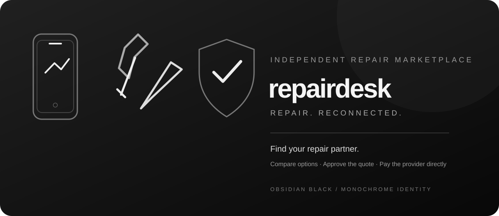

# RepairDesk

  

  <strong>Find your repair partner.</strong> 
  An independent smartphone repair marketplace concept.

---

## Brand direction

RepairDesk uses an **Obsidian Black** foundation with **Electric Blue (`#9BB7FF`) as its primary brand colour**, supported by crisp off-white typography and subtle grey surfaces. Blue leads the calls to action, active states, key highlights and interactive details while black keeps the experience premium and focused. The custom artwork uses simple device, precision-tool and trust-shield motifs to communicate the product without relying on generic stock photography.

## Business model

RepairDesk is a platform connecting customers with independent repair providers. It does not employ technicians, own repair shops, or operate a delivery fleet. Customers should browse verified provider profiles, compare terms, request quotes and choose a provider. Providers independently handle diagnosis, repair, warranty and any agreed logistics.

## Current website capabilities

- Responsive public landing page.
- Custom monochrome SVG brand mark, favicon and homepage illustrations.
- Customer repair enquiry form is a visual prototype only; it does not transmit or store submissions.
- Independent provider application form is a visual prototype only; it does not transmit or store submissions.
- Free pilot pricing: ₹0 provider signup, ₹0 customer platform fee and ₹0 platform commission during the initial pilot.
- Provider directory is intentionally empty until real businesses are verified. No fabricated profiles or ratings.

## Important: not a live marketplace yet

This is currently a static website. It does not yet have:
- provider/customer accounts or automatic provider registration;
- shared database or provider profile management;
- admin verification dashboard;
- searchable provider directory or real-time customer provider selection;
- booking/order tracking, in-app quote approvals, payment processing, automatic split settlements, payouts, reviews or dispute handling.

The initial pilot is free for customers and providers: ₹0 joining fee, ₹0 subscription and ₹0 RepairDesk commission. No customer money is collected by RepairDesk, no platform fee is charged, and no provider payout is processed. Customers pay independent repair providers directly. RepairDesk does not collect, hold, split or transfer repair payments. Real automatic split settlements are not implemented and would require an approved payment partner, merchant/provider onboarding and verified settlement destinations; a mobile number alone is not enough.

Those features require a backend, database, authentication, provider onboarding workflow, payment-provider approval and operational/legal policies. A form submission is not currently transmitted, stored, or treated as a confirmed booking or public provider listing.

## Before operating

Verify provider identity and capabilities; agree provider terms; define who is responsible for device custody, logistics, repair warranty, cancellations, refunds and disputes; use condition photos, accessory checklists and timestamped handover records; publish privacy terms. Never request device passcodes, banking credentials or OTPs.

## Hosting

Static site. Render deploys from the GitHub `main` branch.

## Project links

- **Website:** https://repairdesk-lun8.onrender.com/
- **Repository:** https://github.com/ansh385/repairdesk
